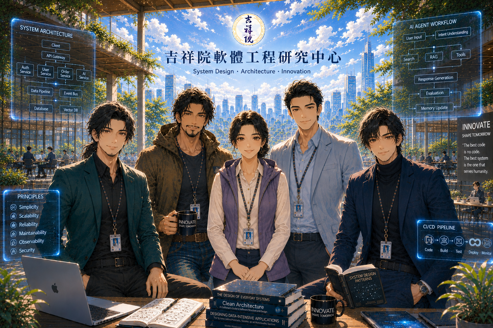

# Auspicious Software Engineering Research Center   吉祥院軟體工程研究中心  

  

## Overview｜概覽  

Sharing knowledge in software engineering—covering process design, management techniques, CI/CD, agile practices, and various frameworks—to help you master the core essentials of development and management.   
分享軟體工程相關知識，涵蓋流程設計、管理技術、CI/CD、敏捷方法與各種框架，帶你全面掌握開發與管理的核心要點。  

---

## Agile Software Project｜敏捷軟體專案

| Guidance 指南 | Description 說明 | 
|:-----|:-------|
| <a href="https://github.com/retamotome/AgileSoftwareProjectGuide" target="_blank"><image src="https://github.com/retamotome/AgileSoftwareProjectGuide/raw/main/img/AgileSoftwareProjectGuide.png" width="200"></a> | [Reta's Agile Software Project Guide｜Reta 的敏捷軟體專案指南](https://github.com/retamotome/AgileSoftwareProjectGuide) A concise, phase-based guide for planning and executing Agile software projects. This repository documents each project phase, recommended practices, and links to supporting videos and artifacts. 本指南提供以「階段」為主軸的精簡指南，說明如何規劃與執行敏捷軟體專案。本儲存庫涵蓋各專案階段、以及建議實務，以及相關教學影片與產出文件連結。  ☑️ English ☑️ Chinese  |  

---

## Software Engineering｜軟體工程

| Video 影片 | Description 說明 | Date 日期 |
|:----|:----------|:--|
| <a href="2025-11-09_AgileProjectMgt/README.md" target="_blank"><image src="2025-11-09_AgileProjectMgt/img/Thumbnail.png" width="200"></a>   | [Lesson 01: Agile and Software Engineering Overview 敏捷與軟體工程全覽](2025-11-09_AgileProjectMgt/README.md) Processes, History, Scope, Comparisons, and Its Impact on Project Management and PDCA 敏捷與軟體工程全覽｜敏捷的流程、歷史、應用範圍與比較，以及它如何影響專案管理與PDCA。  ☑️ English ☑️ Chinese   | 2025-11-09 |    
| <a href="2025-12-08_BusinessReqDef/README.md" target="_blank"><image src="2025-12-08_BusinessReqDef/img/Thumbnail.png" width="200"></a>   | [Lesson 02: Business Requirement Definition 商業需求定義](2025-12-08_BusinessReqDef/README.md) From Concepts to Practice: A Complete Guide! 從觀念到實務．完全攻略！  ☑️ English ☑️ Chinese  | 2025-12-08 |  

---

## System Design｜系統設計

| Guidance 指南 | Description 說明 | 
|:-----|:-------|
| <a href="https://github.com/retamotome/AgileSoftwareProjectGuide/blob/main/SoftwareDevelopmentPhase/System-Design-Considerations/README.md" target="_blank"><image src="https://github.com/retamotome/AgileSoftwareProjectGuide/raw/main/SoftwareDevelopmentPhase/img/PracticalSystemDesignConsiderations.png" width="200"></a> | [Practical System Design Considerations｜系統設計實務考量](https://github.com/retamotome/AgileSoftwareProjectGuide/blob/main/SoftwareDevelopmentPhase/System-Design-Considerations/README.md)  This section provides a concise overview of key reliability strategies and general considerations essential during the Requirement Analysis phase of software engineering and project management, along with practical tips based on my real-world experience. 本章節提供在軟體工程與專案管理的需求分析階段中，關鍵可靠性策略與一般考量的簡要概述，並附上我在實務經驗中的一些實用建議。  ☑️ English ☑️ Chinese  |

| Course 課程 | Description 說明 | 
|:-----|:-------|
| <a href="../OpenCourseware/SystemDesignPhilosophy/README.md" target="_blank"><image src="../OpenCourseware/SystemDesignPhilosophy/img/SystemDesignPhilosophy.png" width="200"></a> | [以四大關鍵思維看系統設計哲學](../OpenCourseware/SystemDesignPhilosophy/README.md) 本課程結合系統思維、軟體工程原則與跨領域觀點，探索系統設計的核心。透過挑戰既有假設、分析取捨，培養學習者洞察問題根源、化繁為簡，並尋找能夠最佳化整體系統的有效解決方案之能力。 This course explores system design through systems thinking, software engineering principles, and interdisciplinary perspectives. By challenging conventional assumptions, analyzing trade-offs, learners will develop the ability to identify root causes, simplify complexity, and discover effective solutions that optimize the system as a whole.   ☑️ Chinese  |  

---

## Software Development｜軟體開發  

探索軟體開發的技巧、觀念與知識分享，帶你掌握實務精華，拓展開發思維。  
Exploring software development through practical tips, key concepts, and knowledge sharing—helping you master essential skills and broaden your development mindset.  

| Video 影片 | Description 說明 | Date 日期 |
|:----|:----------|:--|
| <a href="2025-05-07_ExtremelyCleanCode/README.md" target="_blank"><image src="2025-05-07_ExtremelyCleanCode/img/Thumbnail.png" width="200"></a>   | [Extremely Clean Code 極致精煉程式碼的範例](2025-05-07_ExtremelyCleanCode/README.md) Code Beyond AI’s Reach AI 無法超越的程式碼 Extremely Clean Code is an art. Discard everything unnecessary and handle it in an extremely refined way. Extremely Clean Code 是一門藝術。捨棄沒有必要的一切事物，以極緻精煉的方式來處理。  ☑️ English ☑️ Chinese   |2025-05-07|  

---

## License｜授權條款

  
This work © 2026 by Jen Yuan Pan is licensed under the `Creative Commons Attribution-NonCommercial-ShareAlike 4.0 International`.  
本作品 © 2026 作者 潘貞元（Reta Pan），採用 `Creative Commons 姓名標示－非商業性－相同方式分享 4.0 國際版` 授權。  

For the complete license terms, rights and obligations, restrictions on use, and other applicable conditions, please refer to the [Full License Terms](https://github.com/retamotome/SelfDirectedTraining/blob/main/LICENSE.md). By using this work, you acknowledge that you have read, understood, and agree to comply with such terms.  
詳細授權內容、權利義務、使用限制及其他相關條件，請參閱《[完整授權條款](https://github.com/retamotome/SelfDirectedTraining/blob/main/LICENSE.md)》。您使用本作品，即表示已充分閱讀、確已知悉並同意遵守該等條款與規定，並承認其具有法律約束力。    
