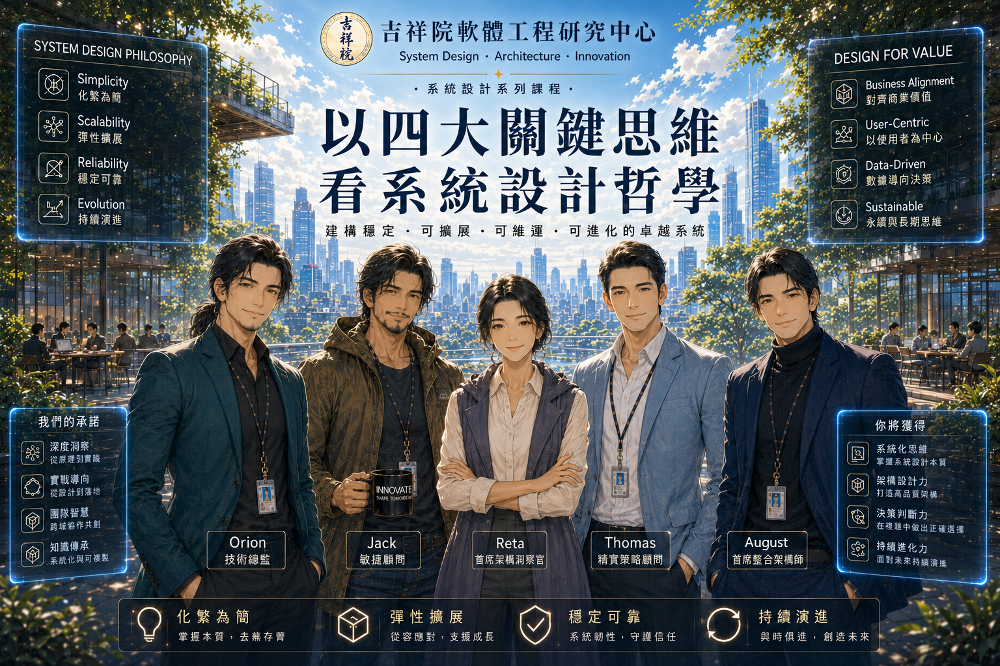

# 以四大關鍵思維看系統設計哲學   

## 從桃花陣到桃花海陣  從《射鵰英雄傳》看系統破綻、破框創新與架構重塑  

  

## 課程簡介

本課程結合系統思維、軟體工程原則與跨領域觀點，探索系統設計的核心。透過挑戰既有假設、分析取捨，培養學習者洞察問題根源、化繁為簡，並尋找能夠最佳化整體系統的有效解決方案之能力。   
This course explores system design through systems thinking, software engineering principles, and interdisciplinary perspectives. By challenging conventional assumptions, analyzing trade-offs, learners will develop the ability to identify root causes, simplify complexity, and discover effective solutions that optimize the system as a whole.   
 ☑️ Chinese Only.

> [!note]  
> 本課程包含對金庸武俠小說部分人物與情節的評論、分析與案例研究，用以說明軟體工程與系統設計概念。所有相關著作權均屬原權利人所有。  

## 課程影片   

| Video 影片 | Description 說明 |
|:----|:----------|
| <a href="https://youtu.be/AjauI1ZIZy8" target="_blank"><image src="img/2026-08-14.png" width="200">  觀看影片</a> | 從桃花陣到桃花海陣 -- 從《射鵰英雄傳》看系統破綻、破框創新與架構重塑  ☑️ Chinese   |

## 大綱   

* 桃花陣更新計畫  
* 案例解析  
    * 在規則內思考的人  
    * 跳出系統的人  
    * 發現真正的弱點  
    * 從破解者變成設計者  
    * 從桃花陣到桃花海陣  
    * 最高階的防禦  
   
---

# 授權條款

以四大關鍵思維看系統設計哲學 © 2026 作者 潘貞元（Reta Pan）。   

課程教材與公開教學內容採用 `Creative Commons 姓名標示－非商業性－相同方式分享 4.0 國際版` 授權。     
詳細授權內容、權利義務、使用限制及其他相關條件，請參閱《[完整授權條款](https://github.com/retamotome/retamotome/blob/main/LICENSE.md)》。您使用本站任何作品，即表示已充分閱讀、確已知悉並同意遵守該等條款與規定，並承認其具有法律約束力。  

角色設定、世界觀設定、人物形象與相關 IP **不** 包含於 Creative Commons 授權範圍內，除另有說明外，[保留一切權利（All Rights Reserved）](../../LICENSE.md)。

## 智慧財產權聲明   

除本授權條款明確授予之權利外，其餘權利均由著作權人保留。  