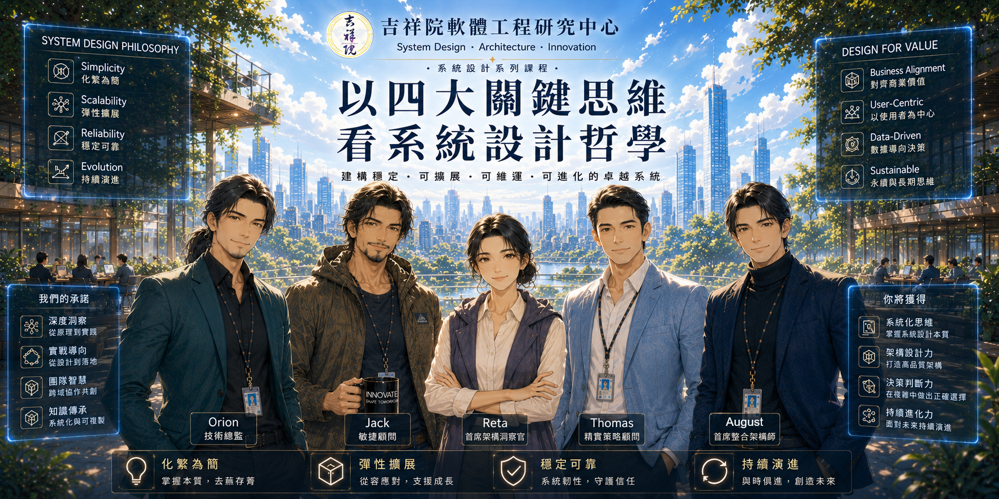

# 以四大關鍵思維看系統設計哲學

  

# 課程簡介

本課程結合系統思維、軟體工程原則與跨領域觀點，探索系統設計的核心。透過挑戰既有假設、分析取捨，培養學習者洞察問題根源、化繁為簡，並尋找能夠最佳化整體系統的有效解決方案之能力。   
This course explores system design through systems thinking, software engineering principles, and interdisciplinary perspectives. By challenging conventional assumptions, analyzing trade-offs, learners will develop the ability to identify root causes, simplify complexity, and discover effective solutions that optimize the system as a whole.   
 ☑️ Chinese Only.

> [!note]  
> 本課程包含對金庸武俠小說部分人物與情節的評論、分析與案例研究，用以說明軟體工程與系統設計概念。所有相關著作權均屬原權利人所有。  

## 登場人物

▶ [技術幕僚成員角色與說明](https://github.com/retamotome/retamotome/blob/main/reference/CharacterBible.md)  

# 課程內容

## 案例系統

| Video 影片 | Description 說明 | Date 日期 |
|:----|:----------|:--|
| <a href="2026-08-26.md" target="_blank"><image src="img/2026-08-14.png" width="200"></a> | [從桃花陣到桃花海陣 -- 從《射鵰英雄傳》看系統破綻、破框創新與架構重塑](2026-08-26.md) | 2026-08-26 |

## Season 01 系統設計  

| Video 影片 | Description 說明 | Date 日期 |
|:----|:----------|:--|
| <a href="" target="_blank"><image src="" width="200"></a> | [ Architecture Thinking、系統架構設計]()   | |
| <a href="" target="_blank"><image src="" width="200"></a> | [架構審查（Architecture Review）]()   | |
| <a href="" target="_blank"><image src="" width="200"></a> | [需求分析]()  | |
| <a href="" target="_blank"><image src="" width="200"></a> | [打造 AI Agent]()  | |
| <a href="" target="_blank"><image src="" width="200"></a> | [打造 Enterprise Architecture]()  | |

## Season 02 管理哲學  

| Video 影片 | Description 說明 | Date 日期 |
|:----|:----------|:--|
| <a href="" target="_blank"><image src="" width="200"></a> | [專案管理哲學]()  | |
| <a href="" target="_blank"><image src="" width="200"></a> | [系統重構]()  | |
| <a href="" target="_blank"><image src="" width="200"></a> | [資安哲學]()  | |
| <a href="" target="_blank"><image src="" width="200"></a> | [雲端架構]()  | |
| <a href="" target="_blank"><image src="" width="200"></a> | [CTO 對談]()  | |

    
## 番外篇  

| Video 影片 | Description 說明 | Date 日期 |
|:----|:----------|:--|
| <a href="" target="_blank"><image src="" width="200"></a> | [安倍晴明 × 服部半藏：五芒星系統架構之道]()  | |
| <a href="" target="_blank"><image src="" width="200"></a> | [五行陣：Authority Matrix Framework 下的團隊成熟度演化模型]() 必修通識課：[Agile Team：Identification and Management｜敏捷團隊：識別與管理](https://github.com/retamotome/SelfDirectedTraining/blob/main/AgileSoftwareEngineering/2026-02-22_AgileTeam/README.md)  | |
| <a href="" target="_blank"><image src="" width="200"></a> | [敏捷江湖：以四大關鍵思維看敏捷]()  | |

## 實戰演練  

| Video 影片 | Description 說明 | Date 日期 |
|:----|:----------|:--|
| <a href="2026-07-30.md" target="_blank"><image src="img/2026-07-30.png" width="200"></a> | [碧海潮生曲的系統架構學 -- 從《射鵰英雄傳》看《易經》、五音、五行到狀態機](2026-07-30.md) | 2026-07-30 |
| <a href="2026-10-23.md" target="_blank"><image src="img/2026-10-23.png" width="200"></a> | 從奇門遁甲到決策工程學（一） [將古代謀略模型轉化為可驗證的 Adaptive Decision Framework](2026-10-23.md) | 2026-10-23 |
| <a href="" target="_blank"><image src="" width="200"></a> | 從奇門遁甲到決策工程學（二） [從控制理論到自我進化決策架構]() | |

   
---

# 授權條款

以四大關鍵思維看系統設計哲學 © 2026 作者 潘貞元（Reta Pan）。   

課程教材與公開教學內容採用 `Creative Commons 姓名標示－非商業性－相同方式分享 4.0 國際版` 授權。     
詳細授權內容、權利義務、使用限制及其他相關條件，請參閱《[完整授權條款](https://github.com/retamotome/retamotome/blob/main/LICENSE.md)》。您使用本站任何作品，即表示已充分閱讀、確已知悉並同意遵守該等條款與規定，並承認其具有法律約束力。  

角色設定、世界觀設定、人物形象與相關 IP **不** 包含於 Creative Commons 授權範圍內，除另有說明外，[保留一切權利（All Rights Reserved）](../../LICENSE.md)。

## 智慧財產權聲明   

除本授權條款明確授予之權利外，其餘權利均由著作權人保留。  