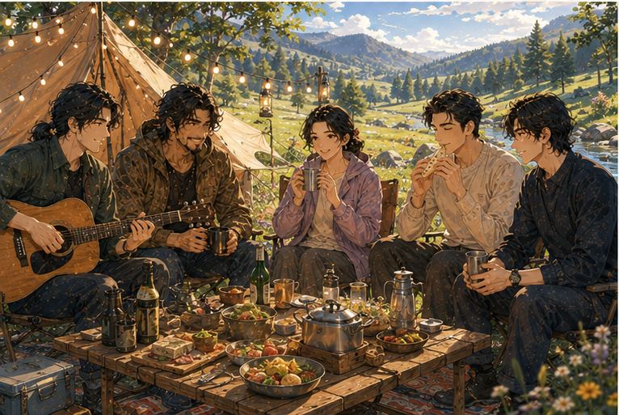

# 吉祥院　日日好日　實踐所  

  

## Overview｜概覽  

分享生活哲學與人生心得，探索超越宗教束縛的觀點與思路，帶你開拓更自由的思維視野。  
Sharing life philosophy and personal reflections, exploring perspectives and ideas that transcend religious constraints—inviting you to broaden your mind with greater freedom.  

## Personal Reflections｜人生心得  

| Book 書籍 | Description 說明 | 
|:-----|:-------|
| <a href="https://books.google.com.tw/books/about/貞元年間_卷一_廿卅隨筆.html?id=Xfi2DwAAQBAJ" target="_blank"><image src="https://books.google.com.tw/books/publisher/content?id=Xfi2DwAAQBAJ&printsec=frontcover&img=1&zoom=1&edge=curl&imgtk=AFLRE73PvxU1eGilUl_T75QX7X-Dv6xNGikUgOPQTzpnsD9PXxizzgzPhj2z2zO-aJvs13VERxv8m_x6kSJpeD1IrUtSwjrxJNi2t8x-vkq-3ihdpShfzHt-_CaCkzi39R_d96F98F1Z" width="200"></a> | [貞元年間 卷(一) 廿卅隨筆](https://books.google.com.tw/books/about/貞元年間_卷一_廿卅隨筆.html?id=Xfi2DwAAQBAJ)  本書主要是集結敝人人生至此的些許見聞、體會與淺見，也在某些觀念給予不同的詮釋 。 在本書【寓】的部分，以淺近文言譬喻生活情境，呈現先賢之言。在【論】的部分，引用各種入世生活主題分享處理與應對之道。此 外，本書也包含與朋友間的交流心得、以及【論．淺談宇宙 】、【 史． 上杉 謙信 】、【 史．織田信長之敦盛 】等等有趣的文章，使本書的內容更豐富。  ☑️ Chinese Only |

| Video 影片 | Description 說明 | Date 日期 |
|:----|:----------|:--|
| <a href="https://youtu.be/Z-Ml2jpvTCQ" target="_blank"><image src="./img/FourNobleTruths.png" width="200"></a> |  [佛陀的策略課：四聖諦 The Buddha’s Strategy Lesson: The Four Noble Truths ](https://youtu.be/Z-Ml2jpvTCQ) 最直白精闢的究竟解脫之路｜安定自心的強大力量｜人生苦海的真正原因 The Most Direct Path to Ultimate Liberation｜The Powerful Force of Inner Stability｜The True Cause of Life’s Suffering  ☑️ Chinese | 2024-12-17 |  
| <a href="https://youtu.be/1yBwxDKRZQc" target="_blank"><image src="./img/Master-Shengyan.png" width="200"></a> |  [聖嚴法師的眾願成就理念之一： 四它 One of Master Sheng Yen’s Concepts of Fulfilling Collective Aspirations: The Four “Its”](https://youtu.be/1yBwxDKRZQc) 最直白精闢的解釋與例證｜人生苦海的真正原因。 The Most Clear and Insightful Explanations with Examples｜The True Cause of Life’s Suffering  ☑️ Chinese | 2024-12-27 |  

---

## License｜授權條款

  
This work © 2026 by Jen Yuan Pan is licensed under the `Creative Commons Attribution-NonCommercial-ShareAlike 4.0 International`.  
本作品 © 2026 作者 潘貞元（Reta Pan），採用 `Creative Commons 姓名標示－非商業性－相同方式分享 4.0 國際版` 授權。  

For the complete license terms, rights and obligations, restrictions on use, and other applicable conditions, please refer to the [Full License Terms](https://github.com/retamotome/SelfDirectedTraining/blob/main/LICENSE.md). By using this work, you acknowledge that you have read, understood, and agree to comply with such terms.  
詳細授權內容、權利義務、使用限制及其他相關條件，請參閱《[完整授權條款](https://github.com/retamotome/SelfDirectedTraining/blob/main/LICENSE.md)》。您使用本作品，即表示已充分閱讀、確已知悉並同意遵守該等條款與規定，並承認其具有法律約束力。    

