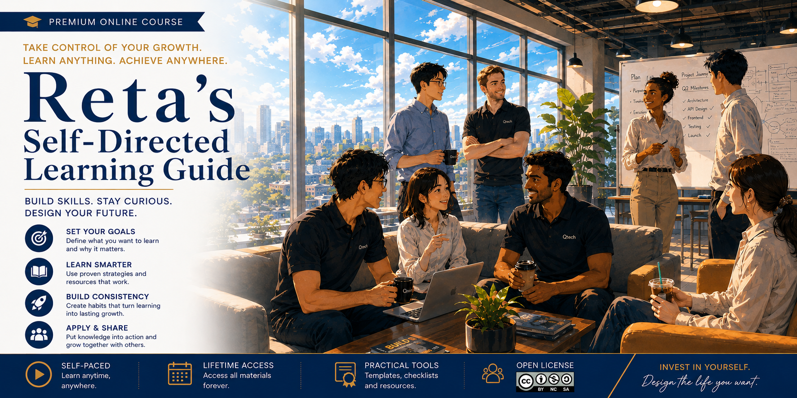

# Reta's Self-Directed Learning Guide   Reta 的自主學習指南  

  

## Overview｜概覽  

| Discipline 領域 | Description 說明 | 
|:-----|:-------|
| <a href="./AgileSoftwareEngineering/README.md" target="_blank"><image src="./AgileSoftwareEngineering/img/sw_cover.png" width="200"></a> | [Auspicious Software Engineering Research Center 吉祥院軟體工程研究中心](./AgileSoftwareEngineering/README.md) Sharing knowledge in software engineering—covering process design, management techniques, CI/CD, agile practices, and various frameworks—to help you master the core essentials of development and management. 分享軟體工程相關知識，涵蓋流程設計、管理技術、CI/CD、敏捷方法與各種框架，帶你全面掌握開發與管理的核心要點。    ☑️ English ☑️ Chinese  |
| <a href="./Management/README.md" target="_blank"><image src="./Management/img/mgt_cover.png" width="200"></a> | [Auspicious Academy of Management 吉祥院管理學院](./Management/README.md) Insights into software management, risk control, cybersecurity governance, and project management—helping you grasp the key principles of management and governance. 分享軟體管理、風險控管、資安治理與專案管理的知識與實務心得，帶你深入探索管理與治理的核心要點。  ☑️ English ☑️ Chinese  |
| <a href="./Technology/README.md" target="_blank"><image src="./Technology/img/tech_cover.png" width="200"></a> | [Auspicious Science and Technology Research Laboratory 吉祥院科學與科技研究室](./Technology/README.md) Exploring science and technology through knowledge sharing, in-depth analysis, and thoughtful observations—guiding you to grasp cutting-edge insights and broaden your perspective. 探索科學與科技的知識分享、深入分析與觀察，帶你掌握前沿洞見，拓展思維視野。  ☑️ English ☑️ Chinese  |
| <a href="./PersonalReflections/README.md" target="_blank"><image src="./PersonalReflections/img/life_cover.png" width="200"></a> | [吉祥院　日日好日　實踐所](./PersonalReflections/README.md)  分享生活哲學與人生心得，探索超越宗教束縛的觀點與思路，帶你開拓更自由的思維視野。 Sharing life philosophy and personal reflections, exploring perspectives and ideas that transcend religious constraints—inviting you to broaden your mind with greater freedom.   ☑️ Chinese  |

---

## License｜授權條款

  
This work © 2026 by Jen Yuan Pan is licensed under the `Creative Commons Attribution-NonCommercial-ShareAlike 4.0 International`.  
本作品 © 2026 作者 潘貞元（Reta Pan），採用 `Creative Commons 姓名標示－非商業性－相同方式分享 4.0 國際版` 授權。  

For the complete license terms, rights and obligations, restrictions on use, and other applicable conditions, please refer to the [Full License Terms](https://github.com/retamotome/SelfDirectedTraining/blob/main/LICENSE.md). By using this work, you acknowledge that you have read, understood, and agree to comply with such terms.  
詳細授權內容、權利義務、使用限制及其他相關條件，請參閱《[完整授權條款](https://github.com/retamotome/SelfDirectedTraining/blob/main/LICENSE.md)》。您使用本作品，即表示已充分閱讀、確已知悉並同意遵守該等條款與規定，並承認其具有法律約束力。    
